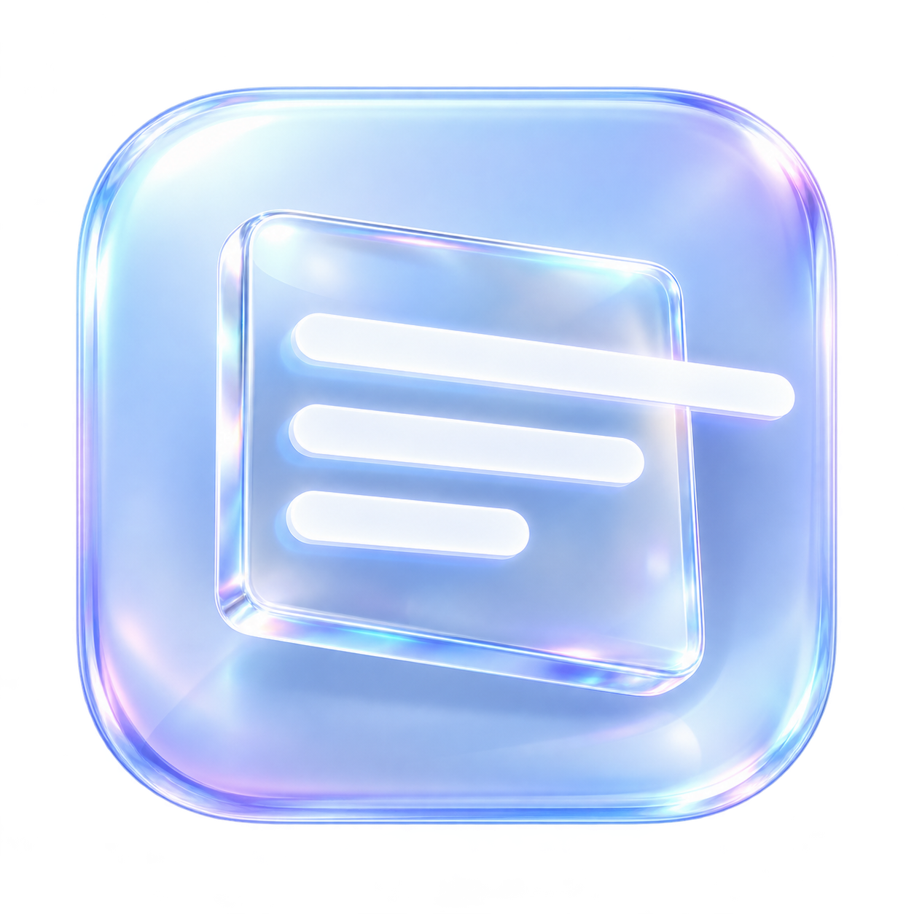
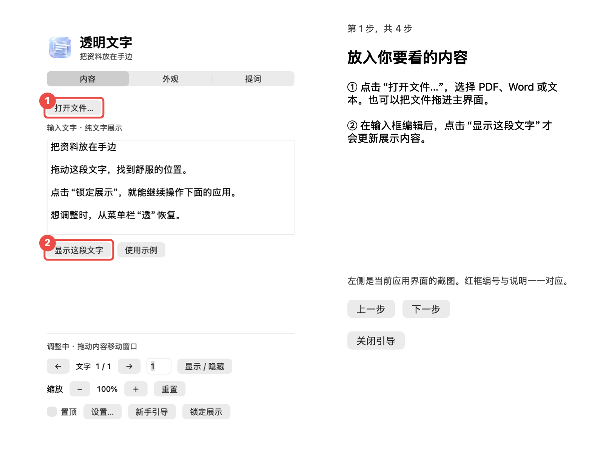

<div align="center">
  
  <h1>GlassText · 透明文字</h1>
  <p>把资料放在手边，让文字浮在正在使用的应用上方。</p>
  <p><a href="https://github.com/YinWenhao-03/GlassText/releases">下载预览版</a> · <a href="docs/USER_GUIDE.md">使用指南</a> · <a href="TESTING.md">验证范围</a></p>
</div>

GlassText 是一款桌面悬浮阅读工具。你可以打开文字、PDF 或 Word，把内容放在合适的位置，锁定后继续操作下面的应用。适合边操作边看资料、对照笔记和演讲提词。

支持 macOS 和 Windows，当前提供预览版。

## 看一眼就能上手



主界面把常用操作分开，复杂设置默认收起。Mac 引导提供四步真实界面截图、红框和编号说明。

1. **放入内容**：打开文件或拖入文档，也可以直接输入文字。
2. **调整阅读**：选择字号和颜色，移动窗口；用 `− / ＋` 调整 50%–300% 缩放。
3. **锁定展示**：窗口背景透明，鼠标穿透，继续操作下面的应用。
4. **恢复操作**：点击“返回调整”，或使用菜单栏 / 托盘与全局快捷键。

## 核心功能

- 透明展示、窗口置顶、鼠标穿透，控制面板独立存在。
- PDF 去白底并保留版式；纯文字分页、字号、颜色和描边。
- 页面放大、缩小和重置；PDF 放大后可以平移查看边缘内容。
- **锁定时是否禁止翻页、是否禁止缩放，可分别选择。** 默认两项均不禁止，仍可通过控制面板操作；展示窗口始终鼠标穿透。
- 导入失败保留原内容，避免正在阅读的资料消失。
- 文件在本机处理，没有文档上传服务。

## Mac / Windows 功能范围

| 功能 | macOS | Windows v0.6.6 预览版 |
|---|---|---|
| 文字 / TXT / Markdown | 支持 | 支持 UTF-8 文本 |
| PDF | 去白开关、强度、缩放、平移 | 去白开关与强度、缩放、平移 |
| Word | DOC / DOCX / RTF 提取文字；可选 LibreOffice 转 PDF 保留版式 | DOCX 提取文字；DOC / DOCX / RTF 可用 LibreOffice 转 PDF 保留版式 |
| 置顶 / 穿透 / 独立锁定选项 | 支持 | 支持 |
| 提词滚动 / 倒计时 / 暂停 | 支持 | 支持 |
| 外观与位置、阅读进度记忆 | 支持 | 保存内容、页码、提词位置、PDF 平移、样式和窗口位置；可清除记录 |
| 多屏与副本 | 显示器切换、越界恢复、最多八个当前页副本 | 显示器选择、越界恢复、最多八个固定画面 |
| 恢复快捷键 | 默认 `⌃⌥⌘G`，设置可选 G/T/R | 默认 `Ctrl+Alt+G`，支持组合键录入和冲突检测 |
| 图文引导 | 四步截图＋编号红框 | 四步面板截图＋红框说明 |
| 发布验证 | 本机编译、自动检查与部分视觉检查 | 跨平台打包、逻辑及浏览器渲染测试 |

## 下载与安装

从 [Releases](https://github.com/YinWenhao-03/GlassText/releases) 选择对应附件。

- **Mac**：下载 `GlassText-macOS.zip`，解压后将 `GlassText.app` 拖入“应用程序”。macOS 13+，包含 Apple Silicon 和 Intel 两种架构。更新前退出旧版本。
- **Windows**：下载 `GlassText-Windows-0.6.6-x64.zip`，完整解压文件夹后运行其中的 `GlassText.exe`，不要只复制 exe。适用于 Windows 10/11 x64。
- 下载页同时提供 SHA-256 校验文件。

应用尚未取得 Apple 公证或 Windows 代码签名。Mac 首次打开可能需要在系统“隐私与安全性”允许打开；Windows 可能出现未识别应用提示。

## 构建与测试

### macOS

安装 Apple Command Line Tools 后，在项目根目录执行：

```sh
bash scripts/build-app.sh
dist/GlassText.app/Contents/MacOS/GlassText --self-test
open dist/GlassText.app
```

构建产物在 `dist/`。测试需要图形登录会话，会短暂打开窗口，使用独立设置域。

### Windows

在 Windows x64 安装 Node.js 22（22.13+）后：

```sh
cd windows
npm ci
npm test
npm run test:electron
npm start
npm run build
```

依赖已锁定在 `package-lock.json`。推送版本标签会运行 [两端构建与发布](.github/workflows/release.yml)，Mac 与 Windows 检查均通过后发布 ZIP 和校验文件；也支持手动触发构建。

## 使用说明与数据保存

- 去白底会影响图片中的白色；扫描件的底色效果取决于页面质量；当前无 OCR 功能。
- Word 保留版式模式依赖 LibreOffice；Mac 使用 `/Applications/LibreOffice.app`，Windows 检测 Program Files 中的标准安装路径，复杂公式、字体和排版仍可能与 Word 不同。
- 置顶适用于普通应用窗口；系统安全界面和部分全屏应用会优先显示。全局快捷键可能被其他应用占用，菜单栏 / 托盘保留恢复入口。
- Mac 本地设置会保存输入文字、最近文件路径、样式和阅读进度；Windows 在 userData 目录保存阅读内容副本、页码、提词位置、PDF 平移和设置，均为未加密的本机数据，可从设置清除阅读记录。两端都不上传文档。图文引导的当前内容截图仅保留在内存。
- 点击“查看更新”进入 GitHub 发布页，下载新版后替换安装。
- 固定画面保留当前页面，最多可创建八个副本。

## 项目结构

```text
Sources/GlassText/     原生 Mac 应用、导入、引导与自动检查
windows/              Windows Electron 应用与测试
scripts/              通用 Mac 构建、可选签名与公证流程
Assets/               生图生成的玻璃图标及 macOS 图标资源
docs/                 用户指南、产品走查与截图
windows/ci/           Windows 自动构建配置示例（未启用）
```

开发计划见 [ROADMAP.md](ROADMAP.md)，测试方法与覆盖范围见 [TESTING.md](TESTING.md)。
